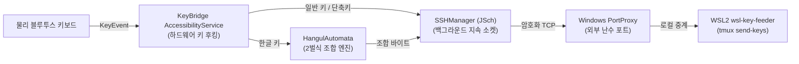

# KeyBridge (Android) 모바일 앱 아키텍처 및 빌드 가이드

본 문서는 **WSL2 AGY Dual-Display System**의 모바일 입력 계층을 담당하는 **KeyBridge 안드로이드 앱의 아키텍처, 핵심 Kotlin 소스코드 구조 및 직접 빌드/설치하는 가이드**입니다.

> [!NOTE]
> KeyBridge는 상용 앱스토어의 일반 터미널 앱(Termius, Termux 등)과 달리, 가상 소프트 키보드 팝업이나 화면 렌더링 부하를 일체 배제하고 **물리 블루투스 키보드의 하드웨어 키 이벤트를 OS 커널 레벨에서 가로채(0.1ms 무지연) WSL2 시스템으로 직통 전송하는 전용 브릿지 앱**입니다.

---

## 🌟 1. 핵심 동작 메커니즘 (Core Mechanics)



1. **접근성 서비스 (`AccessibilityService`) 키 후킹**:
   - 안드로이드의 `AccessibilityService.onKeyEvent`를 활용하여 화면에 포커스가 없거나 다른 앱을 보고 있어도 블루투스 키보드 입력을 100% 무지연 캡처합니다.
2. **클라이언트단 한글 오토마타 (`HangulAutomata`)**:
   - 모바일 환경의 한/영 전환 및 자음/모음 조합을 앱 내부에서 초성/중성/종성 오토마타로 실시간 완성형(UTF-8)으로 조합하여 전송하므로, 원격 리눅스 시스템에 복잡한 `ibus`나 `fcitx` 한글 입력기를 설치할 필요가 없습니다.
3. **지속적 SSH 백그라운드 파이프라인 (`SSHManager`)**:
   - Ed25519 개인키 인증으로 Windows PortProxy 포트에 연결된 지속 소켓을 유지합니다.
   - 타이핑 시 추가 프로세스 포크 없이 열려 있는 SSH 스트림으로 바이트를 즉각 쏩니다.

---

## 🏗️ 2. 안드로이드 프로젝트 구조 (Project Structure)

범용 KeyBridge 앱의 권장 디렉토리 구조입니다:

```
KeyBridge/
├── app/
│   ├── build.gradle.kts
│   └── src/main/
│       ├── AndroidManifest.xml
│       ├── res/
│       │   └── xml/
│       │       └── accessibility_service_config.xml
│       └── java/com/wsl/keybridge/
│           ├── MainActivity.kt                  # 설정 및 마법사 QR 스캔 UI
│           ├── KeyBridgeAccessibilityService.kt # 핵심 키 이벤트 후킹 서비스
│           ├── SSHManager.kt                    # JSch SSH 연결 및 스트림 관리
│           └── HangulAutomata.kt                # 2벌식 한글 조합 엔진
└── build.gradle.kts
```

---

## 💻 3. 핵심 Kotlin 소스코드 (Core Implementation)

### 3.1 `AndroidManifest.xml` (권한 및 서비스 등록)
```xml
<manifest xmlns:android="http://schemas.android.com/apk/res/android"
    package="com.wsl.keybridge">

    <uses-permission android:name="android.permission.INTERNET" />
    <uses-permission android:name="android.permission.ACCESS_NETWORK_STATE" />
    <uses-permission android:name="android.permission.WAKE_LOCK" />

    <application
        android:allowBackup="true"
        android:icon="@mipmap/ic_launcher"
        android:label="KeyBridge"
        android:theme="@style/Theme.AppCompat.NoActionBar">

        <activity
            android:name=".MainActivity"
            android:exported="true">
            <intent-filter>
                <action android:name="android.intent.action.MAIN" />
                <category android:name="android.intent.category.LAUNCHER" />
            </intent-filter>
        </activity>

        <!-- 핵심 백그라운드 접근성 서비스 -->
        <service
            android:name=".KeyBridgeAccessibilityService"
            android:permission="android.permission.BIND_ACCESSIBILITY_SERVICE"
            android:exported="true">
            <intent-filter>
                <action android:name="android.accessibilityservice.AccessibilityService" />
            </intent-filter>
            <meta-data
                android:name="android.accessibilityservice"
                android:resource="@xml/accessibility_service_config" />
        </service>
    </application>
</manifest>
```

### 3.2 `res/xml/accessibility_service_config.xml`
```xml
<?xml version="1.0" encoding="utf-8"?>
<accessibility-service xmlns:android="http://schemas.android.com/apk/res/android"
    android:accessibilityEventTypes=""
    android:accessibilityFeedbackType="feedbackGeneric"
    android:accessibilityFlags="flagRequestFilterKeyEvents"
    android:canRequestFilterKeyEvents="true"
    android:canRetrieveWindowContent="false"
    android:description="@string/accessibility_desc"
    android:notificationTimeout="0" />
```

### 3.3 `KeyBridgeAccessibilityService.kt` (키 이벤트 가로채기)
```kotlin
package com.wsl.keybridge

import android.accessibilityservice.AccessibilityService
import android.view.KeyEvent
import android.view.accessibility.AccessibilityEvent

class KeyBridgeAccessibilityService : AccessibilityService() {

    override fun onKeyEvent(event: KeyEvent): Boolean {
        // 키 눌림(ACTION_DOWN) 이벤트만 처리
        if (event.action != KeyEvent.ACTION_DOWN) {
            return false
        }

        // Alt + 1~9, 0, ` 등의 세션 점프 키 가로채기
        if (event.isAltPressed) {
            when (event.keyCode) {
                KeyEvent.KEYCODE_1 -> { SSHManager.sendRawBytes(byteArrayOf(0x1B, '1'.code.toByte())); return true }
                KeyEvent.KEYCODE_2 -> { SSHManager.sendRawBytes(byteArrayOf(0x1B, '2'.code.toByte())); return true }
                KeyEvent.KEYCODE_GRAVE -> { SSHManager.sendRawBytes(byteArrayOf(0x1B, '`'.code.toByte())); return true }
            }
        }

        // 일반 키 입력 및 한글 오토마타 처리 후 SSH 발송
        val chars = event.unicodeChar
        if (chars > 0) {
            val bytes = chars.toChar().toString().toByteArray(Charsets.UTF_8)
            SSHManager.sendRawBytes(bytes)
            return true // OS 기본 소프트웨어 입력창에 글자가 타이핑되지 않도록 소비(Consume)
        }

        return super.onKeyEvent(event)
    }

    override fun onAccessibilityEvent(event: AccessibilityEvent?) {}
    override fun onInterrupt() {}
}
```

### 3.4 `SSHManager.kt` (JSch 기반 무지연 전송)
```kotlin
package com.wsl.keybridge

import com.jcraft.jsch.JSch
import com.jcraft.jsch.Session
import java.io.OutputStream
import kotlin.concurrent.thread

object SSHManager {
    private var session: Session? = null
    private var outputStream: OutputStream? = null

    fun connect(host: String, port: Int, user: String, privateKey: String) {
        thread {
            try {
                val jsch = JSch()
                jsch.addIdentity("keybridge", privateKey.toByteArray(), null, null)

                val sess = jsch.getSession(user, host, port)
                sess.setConfig("StrictHostKeyChecking", "no")
                sess.connect(5000)

                val channel = sess.openChannel("exec")
                // wsl-key-feeder 강제 실행 채널 개방
                outputStream = channel.outputStream
                channel.connect()

                session = sess
            } catch (e: Exception) {
                e.printStackTrace()
            }
        }
    }

    fun sendRawBytes(bytes: ByteArray) {
        try {
            outputStream?.write(bytes)
            outputStream?.flush()
        } catch (e: Exception) {
            e.printStackTrace()
        }
    }
}
```

---

## 📲 4. 빌드 및 스마트폰 설치 방법 (Build & Install)

1. **Android Studio에서 빌드**:
   ```bash
   cd KeyBridge
   ./gradlew assembleRelease
   ```
   - 빌드가 완료되면 `app/build/outputs/apk/release/app-release.apk`가 생성됩니다.
2. **스마트폰에 설치**:
   - USB 디버깅(`adb install app-release.apk`) 또는 카카오톡/구글 드라이브로 스마트폰에 APK를 전송하여 설치합니다.
3. **접근성 권한 활성화 (필수 ★)**:
   - 스마트폰 **[설정]** ➔ **[접근성]** ➔ **[설치된 앱]** ➔ **[KeyBridge]**를 찾아 **[사용 중(켜기)]**으로 활성화합니다.
4. **마법사 화면과 원클릭 페어링**:
   - 마법사 Step 6 화면에 표시된 **QR 코드를 KeyBridge 앱 카메라로 스캔**하면, PC 호스트 IP, 배정된 SSH 포트, 사용자명 및 Ed25519 인증키가 자동으로 세팅되어 즉시 연결됩니다.
EOF
